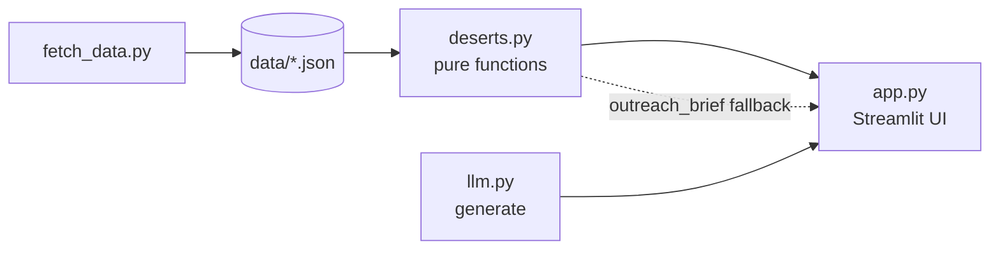
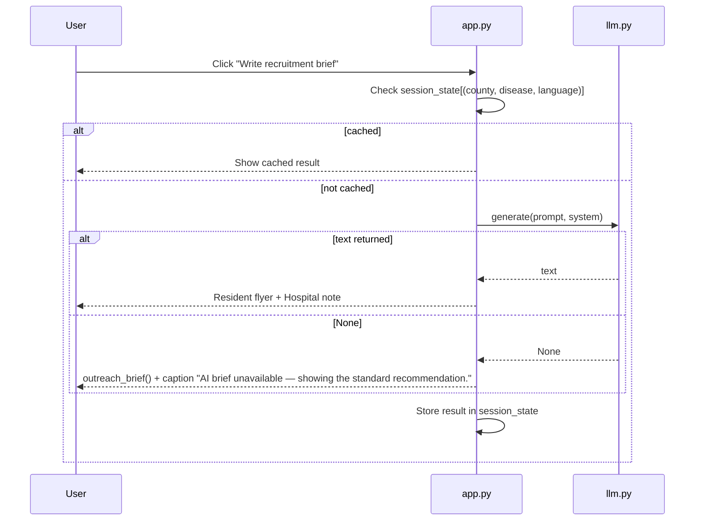

# Design Document

## Overview

TrialReach finds the research deserts of Massachusetts: counties where many adults have a disease but few recruiting clinical trials are within 25 miles. It scores 14 counties for 9 diseases and shows the result on a Streamlit map. It can also write a short recruitment brief with an optional LLM.

Design choices:

- Flat structure. Four Python modules and a `tests/` folder. No extra packages.
- All scoring lives in `deserts.py` as pure pandas/numpy functions, so it is testable without Streamlit.
- Data is downloaded once by `fetch_data.py` and committed in `data/`. The app makes no network calls for data, so it works offline.
- The LLM is optional. Any failure returns `None` and the app shows the rule-based brief instead.
- The score is People_Per_Trial = affected people ÷ (trials in reach + 1). A distance-only score made Hampden look fine (one site 6 miles away) although only 2 trials serve about 56,000 people. This ratio captures both distance and choice and is easy to explain.
- The tool scores places, never people. Only public place-level data is used.

Sources: ClinicalTrials.gov (U.S. NLM), CDC PLACES 2023 county crude prevalence, MassGIS (Census 2020 towns, hospitals, EJ 2020 block groups).

## Architecture



```
fetch_data.py    downloads all datasets into data/
deserts.py       pure scoring functions (pandas/numpy, no Streamlit)
llm.py           one optional LLM call with a safe fallback
app.py           Streamlit UI only
tests/           pytest + hypothesis
data/            saved JSON, committed to git
```

Rules between modules:

- `app.py` imports `deserts` and `llm`. It holds no scoring logic.
- `deserts.py` reads only `data/`. It never imports Streamlit or `requests`.
- `llm.py` reads credentials only from environment variables.
- `app.py` wraps `load_all` and `county_scores` in `st.cache_data`.

## Components and Interfaces

### fetch_data.py

Script, no public functions beyond `main()`. Helpers (private):

| Helper | Purpose |
|---|---|
| `get(url, params)` | `requests.get` with 60 s timeout, 3 retries; raises after the last failure |
| `arcgis_pages(url, params)` | pages with `resultOffset` and `resultRecordCount=1000` until fewer than 1000 rows and no `exceededTransferLimit` |
| `fetch_trials(term)` | follows `nextPageToken`, returns slim records |

Behavior:

- Calls `truststore.inject_into_ssl()` inside `try/except ImportError` before any request.
- Saves `towns.geojson`, `towns.json`, `cdc_places.json`, `trials.json`, `hospitals.json`, `ej.json`, `fetched_at.txt`.
- On a dataset failure after 3 retries: prints which dataset failed and exits with status 1.

### deserts.py

Constants: `REACH_MILES = 25`; `CONDITIONS = {measure_id: label}` for the 9 diseases.

```python
def load_all() -> dict: ...
# keys: towns (DataFrame: town, county, pop, lat, lon), shapes (GeoJSON dict),
#       places (DataFrame), trials (dict measure_id -> list[Trial]),
#       hospitals (DataFrame), ej (DataFrame with county column), fetched_at (str)

def miles(lat1, lon1, lat2, lon2):
    """Haversine miles, Earth radius 3958.8. Scalars or numpy arrays (broadcasts)."""

def trial_sites(d: dict, mid: str) -> pd.DataFrame:
    """One row per (trial, MA site): nct, title, phase, facility, city, lat, lon, county.
    county = county of the nearest town center."""

def town_access(d: dict, sites: pd.DataFrame) -> pd.DataFrame:
    """towns + nearest_miles (min distance to any site)
    + trials_in_reach (distinct NCT ids with a site <= REACH_MILES)."""

def desert_score(affected, trials_in_reach):
    """Pure helper. affected and trials_in_reach are equal-length array-likes (one entry per county).
    Returns (people_per_trial, score): people_per_trial = affected / (trials_in_reach + 1);
    score = round(100 * ppt / max(ppt)), worst county = 100."""

def county_scores(d: dict, mid: str) -> tuple[pd.DataFrame, pd.DataFrame, pd.DataFrame]:
    """Returns (county_df, towns_with_access, sites). county_df has 14 rows, worst first."""

def candidate_hospitals(d: dict, county: str, sites: pd.DataFrame) -> pd.DataFrame:
    """Acute hospitals in county. beds = ICU + MED_SURG + PEDIATRIC,
    nearest_trial_miles. Sorted by beds descending."""

def ej_summary(d: dict, county: str) -> tuple[int, pd.DataFrame]:
    """(total EJ residents, per-town table: ej_pop, neighborhoods,
    limited_english_pct = population-weighted mean of LIMENGHHPCT)."""

def outreach_brief(condition: str, row: pd.Series, state_prev: float,
                   hospitals: pd.DataFrame, ej_pop: int, ej_towns: pd.DataFrame) -> str:
    """Rule-based markdown recommendation. Never empty. Also the AI fallback."""
```

Distance computation uses broadcasting: towns as an `(n, 1)` array and sites as a `(1, m)` array. There are no Python loops over pairs. With no sites, `nearest_miles` and `trials_in_reach` stay finite (see Error Handling).

### llm.py

```python
def generate(prompt: str, system: str = "") -> str | None:
    """One LLM call. Returns None on missing config, any exception, or after 20 s."""
```

| `LLM_PROVIDER` | Call |
|---|---|
| `bedrock` | boto3 `bedrock-runtime` Converse API, model `LLM_MODEL`, AWS credentials from the usual AWS env vars |
| `anthropic` | Anthropic API, key `ANTHROPIC_API_KEY`, model `LLM_MODEL` |
| unset or other | return `None` |

Only the SDK that is actually used is added to `requirements.txt`. The provider is to be confirmed with the organizers.

### app.py

UI only. Layout:

- `st.set_page_config(page_title="TrialReach", page_icon="🌵", layout="wide")`.
- Sidebar:
  - Title "🌵 TrialReach".
  - Disease selectbox (9 labels).
  - Radio "Color the map by": "Research Desert Score (county)" / "Miles to nearest trial (town)".
  - Checkbox "Show trial sites" (default on) and "Show acute hospitals" (default off).
  - A one-sentence score explanation.
- Main page, top to bottom:
  - A. Header: "TrialReach" with the subtitle "Finding the research deserts of Massachusetts. Food deserts have a name. Research deserts don't."
  - B. Four `st.metric` in `st.columns(4)`:

    | Metric | Value | Small text |
    |---|---|---|
    | Recruiting {disease} trials in MA | distinct NCT count | none |
    | Share with a Boston (Suffolk) site | percent | none |
    | Worst research desert | county name | "{people_per_trial:,} people per nearby trial" |
    | Gap vs. Boston | worst ÷ Suffolk people_per_trial, e.g. "21×" | "Boston: N per trial" |

    Small text uses `delta_color="off", delta_arrow="off"`.
  - C. Map (3/5 width) and ranking table (2/5 width).
    - Map: `go.Choroplethmap` on `towns.geojson`, `featureidkey="properties.TOWN20"`, "Reds", white 0.3 px borders.
    - Score mode colors each town by its county score (0–100). Miles mode colors each town by `nearest_miles`, `zmax` = 98th percentile.
    - Trial sites are blue `go.Scattermap` dots deduplicated by (facility, lat, lon). Hospitals are green dots.
    - `map_style="carto-positron"`, center (42.15, -71.75), zoom 6.9, height 560, `st.plotly_chart(fig, config={"scrollZoom": False})`.
    - Ranking: `st.dataframe` with County, Desert Score (`ProgressColumn` 0–100), People per nearby trial, % adults, Trials ≤25 mi, Miles to nearest.
  - D. County deep dive: selectbox "Look closer at a county" (default worst).
    - Left column: Recommendation (`outreach_brief`) and CDC 95% range caption; AI brief controls; "Nearest recruiting trials" table (8 rows, measured from the county's population-weighted center: Miles, Study, Phase, Site city, Record `LinkColumn` to `https://clinicaltrials.gov/study/{nct}` shown as "Open").
    - Right column: "Hospitals that could host a study" (Hospital, Town, Licensed beds, ICU beds, Miles to nearest trial) and "Where outreach has to try harder" (top 10 EJ towns).
  - E. Footer caption with source links and: "TrialReach scores places, never people. Not medical advice. Distances are straight-line from town centers. Licensed beds are not live occupancy."
- UPPERCASE place names are shown in Title Case.
- Empty tables show `st.info` with a friendly sentence.
- If a file in `data/` is missing, `app.py` shows an error message to run `fetch_data.py` and calls `st.stop()`.

### AI brief flow (app.py + llm.py)



Language selectbox: English, Spanish, Portuguese, Haitian Creole, Chinese.

Facts in the prompt (no personal data): county, disease, prevalence %, state average %, people per nearby trial, trials within 25 miles, top candidate hospital and town, the 3 nearest trial titles with NCT ids, and the EJ town with the highest limited-English %.

System prompt rules:

- Use only the facts given. Do not invent numbers, trials or phone numbers.
- Never say the reader qualifies. Say "talk to your doctor or the study team".
- Mention that trial details are on ClinicalTrials.gov.
- Friendly, plain language. No medical advice.

Output format asked of the model:

1. Resident flyer: at most 120 words, in the chosen language, about grade 6 reading level.
2. Hospital note: 3 short lines in English.

## Data Models

### Files in `data/`

| File | Content | Expected size |
|---|---|---|
| `towns.geojson` | FeatureCollection, properties `TOWN20`, `COUNTY20` | 351 features |
| `towns.json` | list of `{TOWN20, COUNTY20, POP2020, INTPTLAT20, INTPTLON20}`; lat/lon cast to float | 351 rows |
| `cdc_places.json` | rows `{year, locationname, measureid, measure, data_value, low_confidence_limit, high_confidence_limit, totalpopulation}`; MA, crude prevalence, 9 measure ids; numbers are strings in the source and are cast on load | 126 rows (14 × 9) |
| `trials.json` | `{measure_id: [Trial]}` | 9 keys |
| `hospitals.json` | list of `{FACILITY_NAME, FACILITY_TYPE, MUNICIPALITY, COUNTY, ICU, MED_SURG, PEDIATRIC, lat, lon}`; null beds stored as 0 | 103 rows (70 acute) |
| `ej.json` | list of `{MUNICIPALITY, TOTAL_POP, PCT_MINORITY, LIMENGHHPCT, BG_MHHI, EJ_CRIT_DESC}`; only `EJ='Yes'` | 2,604 rows |
| `fetched_at.txt` | time of the last download | 1 line |

### Slim trial record

```json
{
  "nct": "NCT01234567",
  "title": "Brief title",
  "conditions": ["Type 2 Diabetes"],
  "phases": ["PHASE2"],
  "sites": [{"facility": "Example Hospital", "city": "Boston", "lat": 42.36, "lon": -71.06}]
}
```

Only locations with `state == "Massachusetts"` and a geoPoint are kept. `phases` may be an empty list.

### Disease search terms

| measure id | label | search term |
|---|---|---|
| DIABETES | Diabetes | diabetes |
| OBESITY | Obesity | obesity |
| DEPRESSION | Depression | depression |
| BPHIGH | High blood pressure | hypertension |
| CHD | Coronary heart disease | coronary artery disease |
| COPD | COPD | COPD |
| CASTHMA | Asthma | asthma |
| STROKE | Stroke | stroke |
| CANCER | Cancer | cancer |

### In-memory tables

- `sites`: nct, title, phase, facility, city, lat, lon, county.
- `towns` after `town_access`: town, county, pop, lat, lon, nearest_miles, trials_in_reach.
- `county_df` (one row per county, worst first): county, pop, prevalence, prev_low, prev_high, affected, avg_miles, trials_in_reach, trials_in_county, people_per_trial, score.

### Research Desert Score

```
pop                = sum of town POP2020 in county
avg_miles          = population-weighted mean of town nearest_miles
trials_in_reach    = population-weighted mean of town trials_in_reach
trials_in_county   = distinct NCT ids with a site in the county
prevalence         = CDC PLACES data_value (%)
affected           = prevalence / 100 × CDC totalpopulation
people_per_trial   = affected / (trials_in_reach + 1)
score              = round(100 × people_per_trial / max(people_per_trial))
```

The `+ 1` keeps zero-trial counties finite. The worst county scores 100.

## Correctness Properties

_A property is a characteristic or behavior that should hold true across all valid executions of a system, a formal statement about what the system should do. Properties are the bridge between human-readable specifications and machine-verifiable correctness guarantees._

Reflection: the formula criteria (3.5–3.7, 3.10) are covered by P1–P3, the distance criterion (2.3) merges into P4, and the trial record criterion (1.7) merges into P5.

### Property 1: Scores are in range and the worst county scores 100

For any list of counties with prevalence 1–40 %, population 1,000–1,000,000 and trials in reach 0–200, `desert_score` returns a score for every county between 0 and 100, and the maximum score is exactly 100.

**Validates: Requirements 3.7, 3.10, 9.9**

### Property 2: More trials never raise People_Per_Trial

For any county inputs, adding trials to one county never increases that county's People_Per_Trial.

**Validates: Requirements 3.6, 9.10**

### Property 3: More affected people never lower People_Per_Trial

For any county inputs, increasing the affected people of one county never decreases that county's People_Per_Trial.

**Validates: Requirements 3.6, 9.11**

### Property 4: Distance is symmetric and zero to itself

For any two coordinate pairs a and b in valid latitude and longitude ranges, `miles(a, b) == miles(b, a)` (within float tolerance) and `miles(a, a) == 0`.

**Validates: Requirements 2.3, 9.12**

### Property 5: Trial record JSON round trip

For any valid slim Trial record (nct, title, conditions, phases, sites with facility, city, lat, lon), serializing to JSON and loading it back produces an equivalent record.

**Validates: Requirements 1.7, 9.13**

## Error Handling

| Situation | Behavior |
|---|---|
| Endpoint fails after 3 retries | `fetch_data.py` prints the dataset name and exits non-zero |
| `truststore` not installed | Fetcher continues without it |
| Saved file missing | `app.py` shows a message to run `fetch_data.py` and stops |
| No LLM env vars, SDK error, or timeout over 20 s | `generate` returns `None`, never raises; UI shows `outreach_brief()` and the caption "AI brief unavailable — showing the standard recommendation." |
| No trial sites for a disease | `nearest_miles` is NaN-free (set to a large finite fallback), `trials_in_reach` is 0, People_Per_Trial stays finite because of `+ 1` |
| County has no acute hospitals, no nearby trials or no EJ towns | UI shows `st.info` with a friendly sentence, not an error |
| All counties have `people_per_trial` of 0 | Not expected with real data; `desert_score` guards division by zero and returns 0 scores |

## Testing Strategy

Run with `python -m pytest -q`. Tests read the saved `data/` and need no network.

Property-based testing applies to the pure functions (`desert_score`, `miles`, the trial record round trip). It does not apply to the fetcher (network I/O), the Streamlit UI (rendering) or the LLM call (external service). Those use example, smoke and manual checks.

### Property tests (`tests/test_properties.py`, Hypothesis)

- One test per property, each run with at least 100 examples (`@settings(max_examples=100)`).
- Each test has a comment tag in this format: `# Feature: trialreach, Property N: <title>`.
- Generators: prevalence 1–40 %, population 1,000–1,000,000, trial counts 0–200, latitudes -90..90, longitudes -180..180, and slim trial records built with `st.builds`.
- Hypothesis is used as is; nothing is built from scratch.

| Test | Property |
|---|---|
| `test_score_range_and_max` | P1 |
| `test_more_trials_not_worse` | P2 |
| `test_more_affected_not_better` | P3 |
| `test_miles_symmetry_identity` | P4 |
| `test_trial_json_round_trip` | P5 |

### Unit tests (`tests/test_deserts.py`)

| ID | Test | Expected |
|---|---|---|
| U1 | `miles(42.36, -71.06, 42.10, -72.59)` (Boston to Springfield) | 75–85 |
| U2 | `county_scores` for each of the 9 diseases | 14 counties |
| U3 | Scores for each disease | 0 ≤ score ≤ 100, max == 100 |
| U4 | Prevalence and `nearest_miles` | no NaN |
| U5 | `candidate_hospitals`, `ej_summary`, `outreach_brief` for every disease and county | run, brief non-empty |
| U6 | Hampden diabetes People_Per_Trial vs Suffolk | more than 10× |
| U7 | `llm.generate` with no env vars | returns `None`, no exception |

### Manual demo checks

1. Diabetes: Hampden is #1, gap about 20×.
2. Miles mode: Berkshire and Cape darker than Boston.
3. Every disease loads without error.
4. AI brief in Spanish for Hampden; fallback appears with no key.

### Agent hook (Kiro)

When `deserts.py` or anything in `tests/` is saved, run `python -m pytest -q` and report failures.
