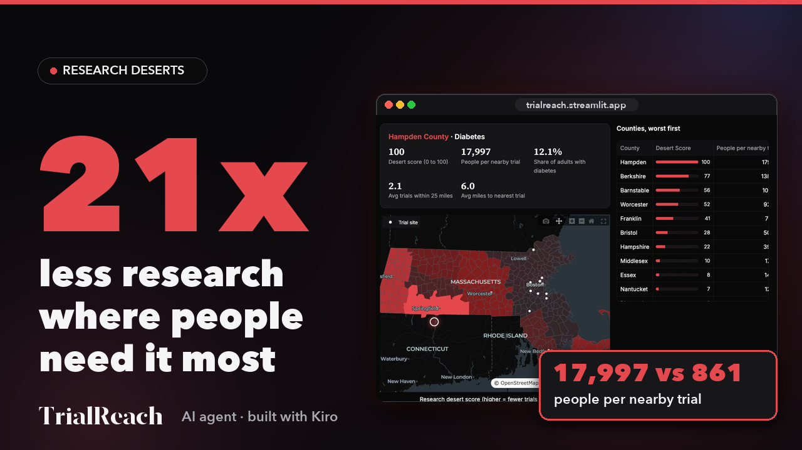

# TrialReach

Finding the research deserts of Massachusetts. Hackachusetts 2026, Healthcare & Biotech, challenge H5 (Making clinical research more accessible).

## Demo video

[](https://youtu.be/S24Cjii2e24)

- Watch on YouTube: https://youtu.be/S24Cjii2e24

- Download the video: [media/TrialReach_demo.mp4](media/TrialReach_demo.mp4)

- Live app: https://trialreach.streamlit.app

## Problem
Clinical trials are not spread evenly. Some counties have many adults with a disease but very few recruiting studies nearby. Hospital research offices, trial sponsors and state health officials need to know where to open the next study site and which communities to reach.

## Finding
For diabetes, Hampden County is the biggest research desert. Its adults per nearby recruiting trial are about 21 times higher than in Suffolk County (Boston). A distance-only view hides this: Hampden has a site only about 6 miles away, but very few trials serve its people.

## Score formula
Scores are per county and per disease. The worst county scores 100.

```
affected         = CDC prevalence % / 100 x county adult population
trials_in_reach  = population-weighted mean of distinct trials with a site within 25 miles of each town
people_per_trial = affected / (trials_in_reach + 1)
score            = round(100 x people_per_trial / max(people_per_trial))
```

The `+ 1` keeps counties with zero nearby trials finite.

## Features
- Map of 351 towns colored by county Research Desert Score or by miles to the nearest trial.
- Nine diseases: diabetes, obesity, depression, high blood pressure, coronary heart disease, COPD, asthma, stroke, cancer.
- County ranking, plus a deep dive: nearest recruiting trials, acute hospitals that could host a study, and environmental-justice towns where outreach has to try harder.
- Plain recommendation for each county, and an optional AI recruitment brief (flyer in 5 languages and a hospital note). With no API key, the app shows the standard recommendation instead.
- Works offline from the saved `data/` folder.

## Data
- [ClinicalTrials.gov](https://clinicaltrials.gov) (U.S. NLM): recruiting studies in Massachusetts
- [CDC PLACES](https://www.cdc.gov/places) 2023: county crude prevalence
- [MassGIS](https://www.mass.gov/orgs/massgis-bureau-of-geographic-information): Census 2020 towns, hospitals, EJ 2020 block groups

## Setup
```bash
python3 -m venv .venv
source .venv/bin/activate
pip install -r requirements.txt
python fetch_data.py     # optional: the data/ folder is already committed
```

## Run
```bash
streamlit run app.py
```

Optional AI brief (set before running; keys are never stored in code):
```bash
export LLM_PROVIDER=anthropic          # or groq, or bedrock (also needs: pip install boto3)
export LLM_MODEL=<model id>
export ANTHROPIC_API_KEY=<your key>    # for anthropic
```

Groq example:
```bash
export LLM_PROVIDER=groq
export LLM_MODEL=openai/gpt-oss-120b
export GROQ_API_KEY=<your key>
```

## Tests
```bash
python -m pytest -q
```
Unit tests U1-U7 (`tests/test_deserts.py`) and Hypothesis property tests (`tests/test_properties.py`).

## Limits
- TrialReach scores places, never people. It uses only public place-level data and is not medical advice.
- It never says a person qualifies for a trial. Residents should talk to their doctor or the study team.
- Distances are straight-line from town centers, not drive time.
- Licensed beds are not live occupancy.
- CDC values are county estimates, and trial listings change daily. Re-run `fetch_data.py` to refresh.
